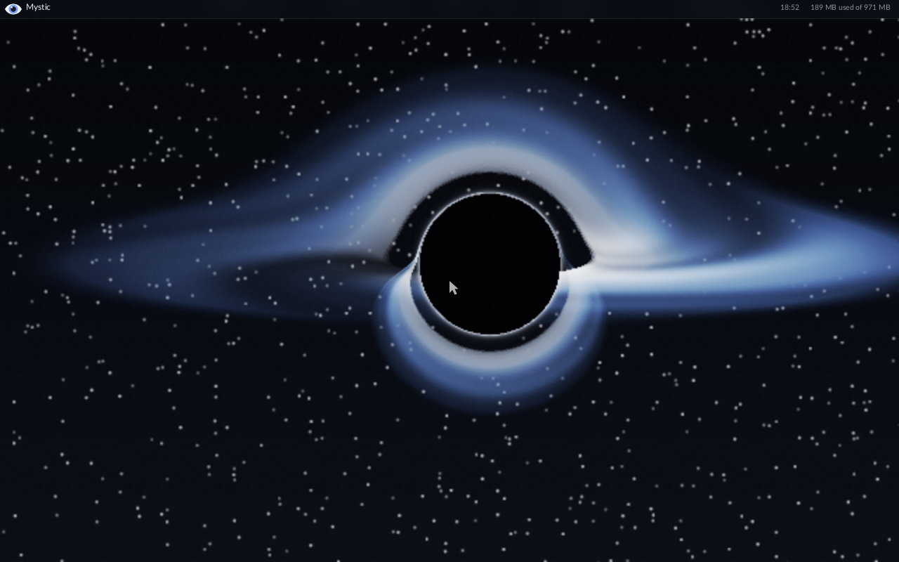
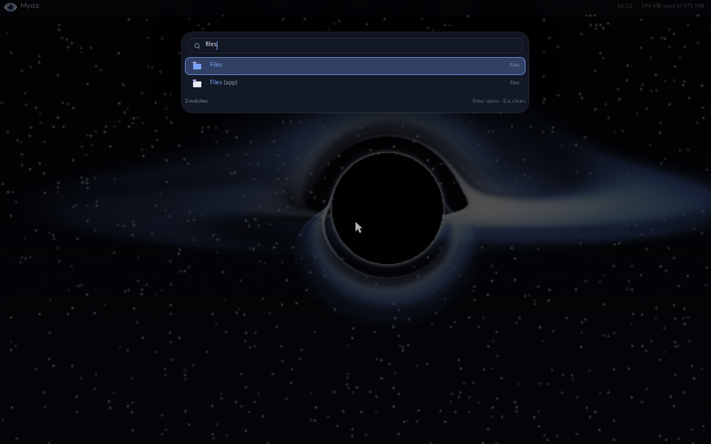
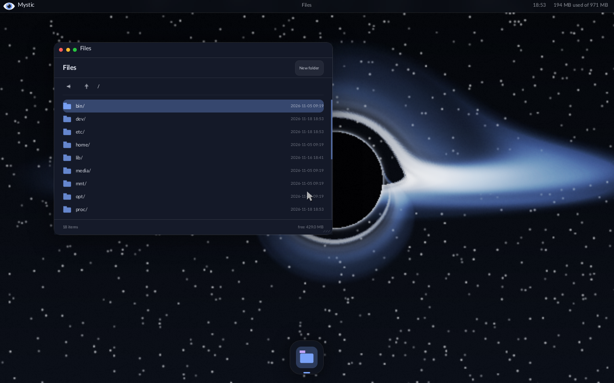
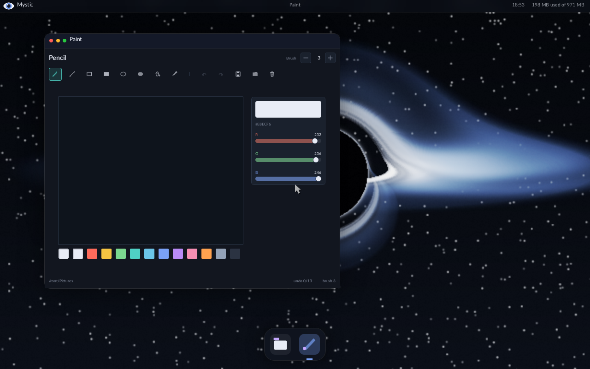
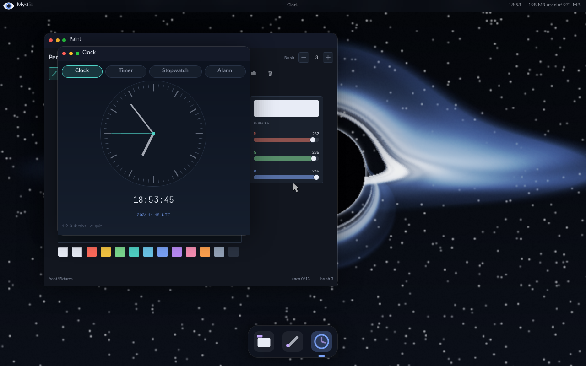
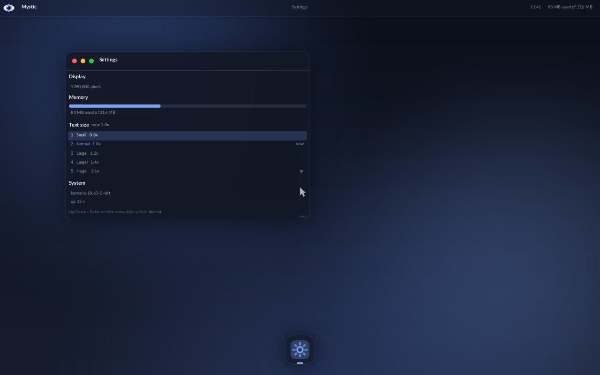
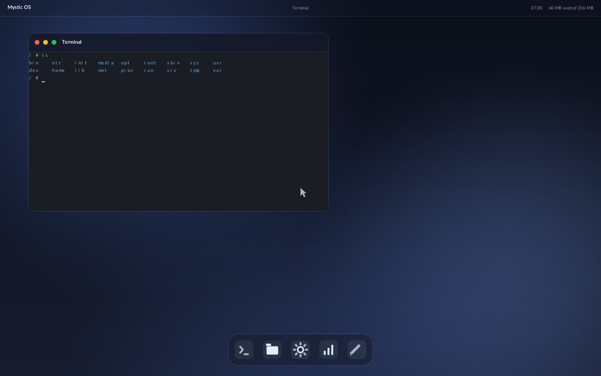

# Mystic OS

**A desktop operating system written from the framebuffer up.**
Own compositor, own window manager, own font rasteriser, own terminal, own
browser, own package manager, own app sandbox — running on a Linux kernel.

26 MB bootable image · boots in under a second · ~70 MB of RAM idle ·
runs on a framebuffer, no GPU, no X11, no Wayland.

[](https://github.com/wishyoulive/mystic-os/releases)
[](#size-and-scope)
[](#what-it-does)
[](#what-it-does)



---

## What it does

| | |
|---|---|
| **Desktop** | Our compositor paints every pixel: rounded windows with real shadows, six themes with per-theme icon styles and animation kinds, four wallpapers plus a **procedural, animated, draggable black hole** |
| **Window manager** | Drag, resize, snap to edges, maximise, minimise, Alt+Tab, 60+ keyboard shortcuts with an on-screen reference (`Super+/`) |
| **Launcher** | Grid of every app, or **type to search** — filters on name then bundle id, `Enter` runs the best match, `:` switches theme |
| **Apps** | Terminal with a real pty and scrollback, Files, Settings, Monitor, Notes, Calculator (scientific, portrait), Store, System, Clock, Paint, 2048, Life, Mandelbrot (unbounded zoom), Sysmon, Viewer, Documents, Browser |
| **Browser** | Our own HTTP/1.1 + **TLS 1.2** client and our own HTML/CSS renderer: text, headings, links, images (PNG + JPEG), the CSS box model (margins, padding, borders, backgrounds, centred `max-width` columns, `text-align`, `line-height`), text selection and copy |
| **Packages** | `pkg` + the Apps Store: index with sizes and SHA-256, **resumable** transfers, size and hash verification before unpacking, install to `/root/apps`, launch without a reboot |
| **Sandbox** | Every bundle runs as its own process in its own mount/network/IPC/UTS namespace, chrooted, uid-dropped, with all inherited descriptors closed and only the files it needs bound in |
| **Files** | 75-format registry driving per-type icons, create a file of any format, open-with by type, right-click menus, a **file picker** for open/save |
| **Sound** | Direct ALSA `hw_params`/`writei`/`drain` from userspace, no sound library: the Clock's alarm and timer ring, `beep` plays tones and WAVs |

## Screenshots

| Launcher search | Files | Paint |
|---|---|---|
|  |  |  |

| Clock | Settings | Terminal |
|---|---|---|
|  |  |  |

## Run it

```bash
# the release contains a bootable ISO and a QEMU bundle
unzip mystic-os-v1.zip
./run.sh                 # or: qemu-system-x86_64 -cdrom mystic-os.iso -m 1024
```

From source:

```bash
./image.sh               # build the image and boot it in QEMU
./image.sh probe         # boot headless and print what the machine reports
./image.sh --hw          # hardware kernel variant (webcam, USB audio, Wi-Fi)
./tools/serve-repo.sh    # serve packages to the VM
```

Needs QEMU and `zig` — the builder fetches the kernel and base rootfs itself.
No compiler toolchain beyond that, no cross-distro setup, works from Windows.

## How it is built

```
src/                    the desktop (C, no dependencies beyond musl)
  main.c                compositor, window manager, launcher, chrome
  wmsrv.c               window server + app sandbox
  gfx.c font.c fb.c     rasteriser, TrueType, framebuffer
  input.c               evdev, including multitouch trackpad gestures
  term.c                our terminal: pty, grid, scrollback, selection
  ui.c theme.c          one global text scale, theme parser
  audio.c               ALSA PCM from userspace
  img.c css.c filetypes.c clipboard.c notify.c   libraries
  apps/                 in-desktop apps
  client/               the SDK, the IPC protocol, out-of-process apps
stage/                  our userspace: init, pkg, themes, the archive root
tools/                  kernel fetch, image builder, package repo, ISO
docs/                   architecture, security, hardware, context dump
```

**The bargain:** a Linux kernel does hardware, scheduling and filesystems;
everything a user *sees and touches* is ours. Same trade Android and ChromeOS
made, at 1/1000th the size.

### Size and scope

| | |
|---|---|
| Own code | ~120,000 lines (78k excluding the vendored TLS and TrueType libraries) |
| Bootable image | 26 MB ISO · 15.9 MB rootfs · 13 MB kernel |
| Idle RAM | ~70 MB, ~190 MB with a browser and ten windows |
| Boot to desktop | 0.9 s in a VM |
| Kernel modules in the image | 222 (virt); the `--hw` variant carries 1,909 |
| Packages | installable at runtime, never in the image |

### Security model, stated plainly

Apps launched from a bundle are sandboxed: `unshare` of mount, network, IPC and
UTS namespaces, a chroot containing only what the app needs, a dedicated uid,
and every inherited file descriptor closed — so a jailed app cannot see the
framebuffer or the keyboard. A bundle that needs the network says
`network = host`; one that needs sound says `audio = yes`; one that reads other
processes says `procs = yes`. Privileged actions travel as request files the
desktop polls, so a sandboxed app never forks.

**Not done, and not claimed:** the in-desktop apps and the terminal are not
sandboxed (they run inside the compositor), disk encryption is designed but not
in the image, packages are SHA-256 verified but not yet signed end-to-end, and
there is no multi-user support. See [docs/SECURITY.md](docs/SECURITY.md).

### What does not work yet

Being explicit is cheaper than being trusted less:

- **Video playback** — the `vlc` package builds (libVLC + 27 plugins, 38.8 MB)
  and the player links, but no frame has been decoded in the VM yet.
- **TLS 1.3** — sites that require it fail with alert 70; our TLS is 1.2.
- **Full HTML/CSS/JS** — our renderer is a real CSS box engine, not a browser
  engine. Tables and form controls are still missing; a real engine belongs in
  an installable package ([docs/ENGINE.md](docs/ENGINE.md)).
- **Encryption, package signing, Wine, webcam apps** — designed or partly
  built, not shipped.
- **Real hardware breadth** — `amdgpu`, Wi-Fi and USB audio need the `--hw`
  kernel variant; firmware for AMD GPUs is not packaged yet.

## Documentation

| | |
|---|---|
| [docs/ARCHITECTURE.md](docs/ARCHITECTURE.md) | how the desktop, IPC and boot fit together |
| [docs/SECURITY.md](docs/SECURITY.md) | the sandbox, what it stops, what it does not |
| [docs/HARDWARE.md](docs/HARDWARE.md) | which kernel supports which hardware |
| [docs/GESTURES.md](docs/GESTURES.md) | trackpad protocol, thresholds, mapping |
| [docs/THEMES.md](docs/THEMES.md) | the theme format, icon styles, animation kinds |
| [docs/CONTEXT-DUMP.md](docs/CONTEXT-DUMP.md) | the state of the world, for whoever picks it up next |
