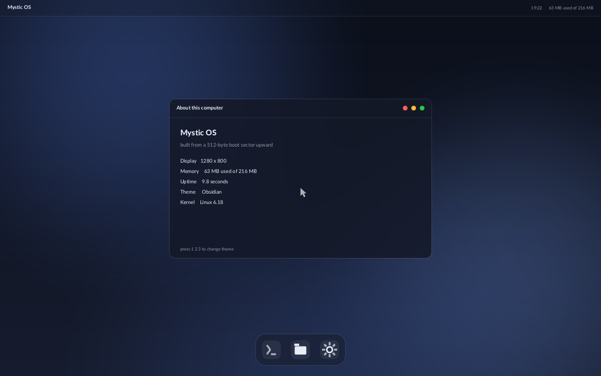
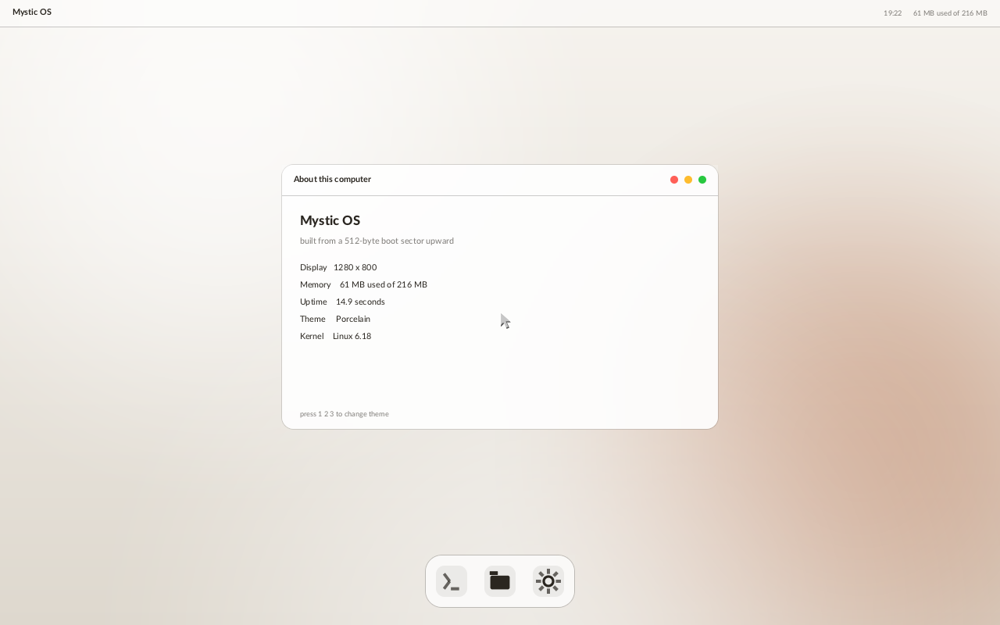
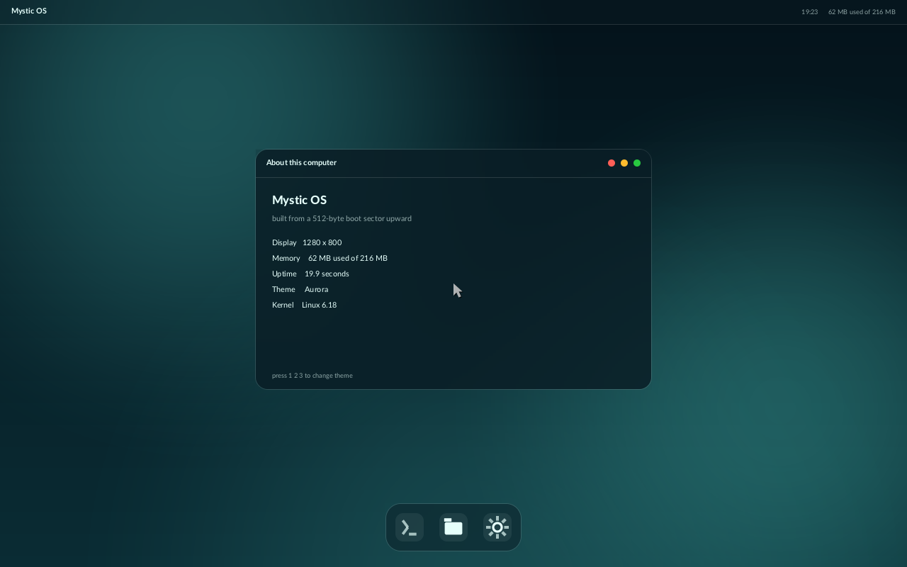

# MYSTIC OS

A small, fast, secure desktop operating system for old PCs.
Runs Linux apps natively, Windows apps through Wine.

Not a distro remix: the desktop is ours — our compositor, our renderer, our
themes, our security model. Everything below was built and booted here.



## What works today

A real desktop, drawn pixel by pixel by our own compositor on a bare
framebuffer. No X11, no Wayland, no GPU driver.

| | |
|---|---|
| Boot | 0.43 s to userspace (hardware accelerated in a VM) |
| Disk | 64 MB virtio disk, FAT, formatted on first boot; `/root` persists |
| Memory | ~62 MB used of 216 MB, including kernel + rootfs |
| Image | 6.5 MB rootfs, 13 MB kernel |
| Graphics | bochs/simpledrm framebuffer, 1280×800, 32bpp |
| Text | real TrueType rasterising (Lato), antialiased |
| Themes | three, switched live with the number keys |
| Input | evdev keyboard + mouse, drag windows, dock launching |
| Apps | Terminal (real pty + sh), Files, Settings, Monitor, Notes |

Press `1` `2` `3` to switch theme. Drag the title bar to move the window.

| Obsidian | Porcelain | Aurora |
|---|---|---|
|  |  |  |

## Build and run

```bash
./image.sh            # build and boot the desktop in a window
./image.sh probe      # boot headless, print machine facts, power off
./image.sh shot 10    # boot headless, screenshot after 10 s
./image.sh themes     # boot once, screenshot all three themes
```

Nothing needs to be installed except QEMU, zig and nasm — and the builder
fetches the kernel and base rootfs itself.

## Layout

```
src/              the desktop: C, no dependencies
  main.c          the desktop itself: layout, dock, window, event loop
  gfx.c           CPU drawing: gradients, rounded rects, real blur, polygons
  font.c          TrueType rasterising via stb_truetype
  fb.c            /dev/fb0
  input.c         /dev/input/event* (evdev)
  theme.c         the theme file parser
stage/            our userspace - the only files that are "us"
  init            PID 1
  etc/mystic/themes/*.theme
tools/
  fetch-kernel.sh get a kernel + exactly the modules we need
  build-desktop.sh cross-compile the desktop into the rootfs
  mkimage.py      pack a rootfs image (works where symlinks can't be made)
  ppm2png.py      QEMU screenshots -> PNG
image.sh          the whole pipeline
boot/             stage 1: our own 512-byte boot sector (kept as a lesson)
```

## Design targets

| | Target | Now |
|---|---|---|
| Idle RAM | under 128 MB | 62 MB |
| Boot to desktop | under 2 s | 0.43 s (VM) |
| CPU baseline | x86-64 without SSE4.2 / POPCNT | not yet measured |
| Apps | Linux native, Windows via Wine | not yet |
| Security | read-only root, per-app sandbox, visible permissions | not yet |

## Rules this project keeps

1. Nothing is "done" until it has been built and booted here.
2. No file grows by copy-paste. Duplication gets deleted.
3. One idea at a time. The next one starts when the last one boots.
4. Claim nothing that was not measured on this machine.
5. No placeholder assets. The fonts are real fonts, the numbers are real
   numbers read from /proc, the screenshots are real screenshots.
